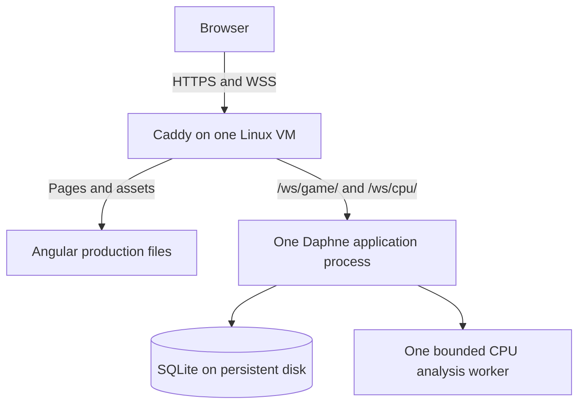

# Student deployment plan for ChessPlusPlus

Updated 17 Oct 2026. **Plan only: nothing has been provisioned or deployed.**
This replaces the unimplemented GitHub Pages/Fly.io proposal; its original text
remains in Git history at `489d8b9:DEPLOYMENT.md`. The owner requires **$0 personal
spending**, including a domain. [REL-003](specs/REL-003-student-deployment.md) owns
acceptance, research/check evidence and remaining decisions.

## Decision and limits

For an initial student beta, use **one eligible Azure Linux VM**, with Caddy
serving the Angular build and proxying WebSockets to one Daphne application
process. Keep SQLite on persistent local storage. This fits the existing
same-origin sockets and avoids changing database engines or distributing the game server.

This is a recommendation conditional on the actual account allowances and a
passing capacity test. Azure for Students advertises $100 credit usable within
12 months, annual student revalidation, and new-customer VM allowances of
750 hours/month for eligible sizes during the first 12 months. Credit renewal
and a new customer's expiring free-service allowance are different benefits.
Copilot Student alone does not activate Azure or a registrar offer. Verify
eligibility, remaining credit, free meters and expiry in the owner's account.
[Azure student benefits](https://azure.microsoft.com/en-us/free/students/),
[student offer terms](https://azure.microsoft.com/en-us/pricing/offers/ms-azr-0170p/).

**A permanent custom domain and unlimited hosted CPU/PvP are not established as
free.** Keep personal spending at zero by retaining the student spending limit,
avoiding separately billed purchases, disabling domain renewals and accepting
service suspension when benefits run out. A registration offer is generally
first-year-only; no domain availability or checkout price has been verified.

## Why this Azure option

| Option | Fit for the current game | Decision |
|---|---|---|
| Eligible Linux VM | Persistent SQLite, long-lived WebSockets and bounded CPU analysis on one host. | Preferred, subject to verified allowances and capacity. |
| Static Web Apps Free / GitHub Pages | Can serve Angular, but cannot run this Daphne/CPU backend. Splitting hosts also needs explicit socket configuration and static-route handling. | Useful future offline fallback; insufficient alone for the full game. |
| App Service Free F1 | Shared CPU quota and limited WebSocket connections constrain games plus CPU analysis. | Avoid for this beta. |
| Container Apps Consumption | Supports containers, but free compute/request grants are finite; local container storage is ephemeral. Durable storage and deployment overlap need additional design. | Reconsider after storage/scaling requirements justify it. |
| Functions / AKS | Would add a hosting redesign or cluster costs to the present stateful ASGI service. | Unnecessary for this launch. |

App Service Free currently limits CPU to 60 minutes/day and Linux WebSockets to
five concurrent connections. Container Apps bills allocated compute and requests
beyond its grants; scaling to zero does not preserve a local database.
[App Service limits](https://learn.microsoft.com/en-us/azure/azure-resource-manager/management/azure-subscription-service-limits#app-service-limits),
[Container Apps billing](https://learn.microsoft.com/en-us/azure/container-apps/billing),
[Container Apps storage](https://learn.microsoft.com/en-us/azure/container-apps/storage-mounts).

## Keep personal spending at zero

1. Use the actual **Azure for Students** subscription. Keep its spending limit
   enabled; do not upgrade to Pay-As-You-Go or remove that limit. When credit is
   exhausted the subscription can be disabled, interrupting the site. Do not buy
   Marketplace products or support plans billed outside the credit protection.
   [Spending-limit scope and exceptions](https://learn.microsoft.com/en-us/azure/cost-management-billing/manage/spending-limit),
   [student subscription suspension](https://learn.microsoft.com/en-us/azure/cost-management-billing/manage/azurestudents-subscription-disabled).
2. Before creating resources, record the selected region/SKU, eligible free
   amounts, expiry, remaining credit and the **whole monthly estimate**. Include
   VM compute, OS disk, public IPv4, outbound transfer, backup storage/operations
   and any monitoring. A free VM meter does not make every attached resource free.
   Use the [Azure calculator](https://azure.microsoft.com/en-us/pricing/calculator/)
   and [IP pricing](https://azure.microsoft.com/en-us/pricing/details/ip-addresses/).
3. Keep one VM and one persistent OS disk; choose a verified free-eligible disk
   or include its charge against student credit. Avoid paid NAT gateways, load
   balancers, Bastion, Azure DNS zones, ACR and managed database/Redis services for
   this design. Use registrar DNS, ordinary SSH keys and a free TLS certificate.
4. With remaining credit R and M months until expiry, R/M is the maximum average
   credit burn for that period, before reserving headroom. A fresh $100 over
   12 months averages $8.33/month; this is a funding calculation, not a VM quote.
   If the estimate exceeds it, document a shorter funded period or revise the
   resource selection. Do not promise a full year of hosting from credit alone.
5. Add available cost/credit alerts and check actual usage after launch. Azure
   budgets notify; they do **not** stop consumption and may lag. The subscription
   spending limit, within its documented scope, is the protection against turning
   this into paid hosting. [Budget behavior](https://learn.microsoft.com/en-us/azure/cost-management-billing/costs/tutorial-acm-create-budgets).
6. Before credit/service expiry, export consistent database backups and local
   replays. Deallocate the VM when closing the beta; disks/IP/storage can still
   consume credit until intentionally removed after backup. Stop service rather
   than authorize a paid upgrade automatically. Recheck renewal eligibility each
   year instead of assuming all initial free meters reset.

## Domain and HTTPS

Choose the address before launch so browser saves and reconnect credentials do
not become stranded on another origin. Examples below are proposals, not claimed
registrations or DNS changes.

| Route | Initial cost | Renewal / conditions |
|---|---|---|
| A standard Name.com domain from its GitHub Student offer | $0 only if the current eligible checkout confirms it. Choose from the offered extensions; premium names are excluded from this plan. | First year; verify terms, disable automatic renewal and paid trial add-ons. |
| A Namecheap student `.me` domain | First year is advertised free, subject to redemption eligibility and name availability. | Ordinary renewal is paid; turn off auto-renew, including bundled certificate products. |
| `chess.ruinanding.com`, if the owner controls that DNS | No additional domain registration fee. | Depends on the parent's existing registration/renewal; no changes to the portfolio site are needed for a new subdomain. |
| The VM's Azure DNS-label hostname | No separate custom-domain registration. | Tied to the Azure resource/subscription; useful for staging or if no student domain can be redeemed. |

The student pack lists eligible Name.com extensions; Namecheap states its
first-year duration and subsequent renewal. Do not infer that a preferred `.com`
is free. Redeem through the actual offer and proceed only with a $0 checkout.
[GitHub Student Pack](https://education.github.com/pack),
[Name.com offer](https://github.com/namedotcom/student-pack),
[Namecheap offer and renewal](https://nc.me/landing/github),
[Azure VM DNS label](https://learn.microsoft.com/en-us/azure/virtual-machines/create-fqdn).

Point the selected hostname at the VM's verified public IP using free registrar
DNS. Add only the chosen game records; preserve existing website and mail DNS.
Publish an IPv6 record only after IPv6 routing is tested. Caddy handles
certificate issuance/renewal and HTTPS redirection; no paid SSL purchase is
needed. Verify public DNS, ports 80/443 and certificate renewal on the target.
[Caddy automatic HTTPS](https://caddyserver.com/docs/automatic-https).

Record domain expiry and reminders before renewal. If preserving the domain
would cost money, switch to an available no-registration-fee hostname or stop the
site. Export local saves/replays before changing origins; DNS changes do not
migrate browser storage. Never enable a paid domain renewal to keep the link alive.

## Runtime architecture

Use an eligible x86 Linux image. Evaluate `Standard_B2ats_v2` first when the
portal confirms the allowance; B1s is another advertised eligible size. The
B2ats_v2 has only 1 GiB RAM and burstable CPU, so neither name nor free eligibility
proves capacity. Build off-host, start with one CPU worker, measure memory and
sustained CPU-credit behavior, and verify timers during analysis. Do not silently
replace it with a larger paid SKU or disable game features to pass the check.
If no funded size meets the checks, leave launch pending.
[VM sizes and burst limits](https://learn.microsoft.com/en-us/azure/virtual-machines/sizes/general-purpose/basv2-series).

Preserve exactly one Daphne process/instance with the current in-memory channel
layer. Its CPU subprocess is separate from that application-process constraint.
SQLite and a stable production secret survive application replacement. The live
database belongs outside release/image directories; use a consistent SQLite
backup API and restore-test an off-VM copy. Do not place the production database
on ephemeral container storage, copy the developer database, or use an unsafe
live-file copy as the backup procedure.

Serve client deep links through an SPA fallback while routing `/ws/` before that
fallback. `websocketUrl()` already uses the page's origin outside dev port 4200;
this deployment needs no new public backend hostname setting or generic CORS
package. Proxy both game and CPU sockets with appropriate limits. Deny public
admin access unless the owner needs it. Bind Daphne privately, restrict SSH and
verify only intended HTTP hosts/WebSocket origins. Caddy supports WebSocket
proxying; confirm reconnect behavior across proxy/backend updates.
[Proxy behavior](https://caddyserver.com/docs/caddyfile/directives/reverse_proxy).

## Implementation sequence and release gates

These are **future implementation steps**, not instructions already applied.
Changes stay in ChessPlusPlus, with one writer per file. Preserve local ports
4200/8000, the owner's database and unrelated repositories.

1. **Dependency readiness.** Triage the 17 Oct production-dependency audit
   (nine affected packages: five high, four moderate; not nine demonstrated game
   exploits). Upgrade Angular 19 to a supported version, fix applicable package
   advisories and audit Python/build dependencies. Run both suites, schema/parity
   and migration checks, build and the required full layout sweep after the
   framework upgrade. [Angular support](https://angular.dev/reference/releases).
2. **Reproducible package.** Build Angular and the Python backend from the same
   exact commit on CI, using the tested Node/Python versions (currently 22/3.14).
   Include the required `shared/` files, including CPU policy and legacy match
   contracts. A small pinned backend container can preserve the runtime; keep
   SQLite mounted outside it. Exclude `.git`, local settings, secrets, venvs,
   node_modules and local databases from release contents. No paid registry is
   required; choose distribution only after its free allowance is verified.
3. **Production configuration.** Implement a configurable database path (proposed
   `DJANGO_DB_PATH`; currently absent), persistent storage, static assets and
   health checks. Set production DEBUG false, a unique stable secret, exact hosts,
   trusted proxy handling, secure cookies and HTTPS policy. Keep `REDIS_URL`
   unset and `CPP_CPU_WORKERS=1` for this design. Run Django's deployment checks
   against the actual production settings; all local `manage.py` checks retain
   `DJANGO_DEBUG=true`. [Django checklist](https://docs.djangoproject.com/en/6.0/howto/deployment/checklist/).
4. **Account/domain preflight, then staging.** Verify the actual no-cash funding
   and domain selection above before provisioning. Use one resource group with
   no paid add-ons. Apply all existing migrations to a fresh production/staging
   database and verify backups/restores. Do not keep a second always-on staging
   VM consuming another allocation; stage sequentially on the one host.
5. **Real target verification.** From separate browsers/connections test login,
   lobby, Myself, CPU, PvP, custom configuration, abilities, staged Undo, timeout
   commits after disconnect, reconnect, completed matches, replay save/import,
   rewind and branching. Check deep-link refresh, TLS/WSS, hostile origins and
   health failures. Restart with a saved game and confirm state/draft/replay
   persistence. Measure load and CPU throttling on the selected SKU; document
   tested capacity and remaining limits instead of inferring readiness from CI.
6. **Controlled launch and operation.** Publish the exact verified frontend/
   backend pair after the target checks pass. Keep a previous artifact and a
   tested compatible rollback; back up before schema changes. Avoid replacing
   a backend during active games without an announced interruption plan.
   Bound logs and backup retention, monitor disk/memory/errors and actual credit
   burn, and retain the expiry/stop procedure. Deployment remains a separately
   authorized action; this documentation request provisions nothing.

## Existing behavior to preserve

Rooms, board/history, frozen rules, ability state, revisions, private TurnDrafts
and recorded replay journals survive only with the persistent database. Apply all
migrations; older matches with no journal cannot export a complete replay.
In-process turn/disconnect tasks disappear on restart; persisted deadlines and
drafts allow the next successful join to re-arm them. They do not all restart
merely because the process starts. Test an expired deadline and saved draft on
rejoin, and do not promise interruption-free deployments.

Myself and imported replay rules run locally after the app is loaded; CPU
opponents require `/ws/cpu/`. A stopped all-in-one VM cannot serve fresh page
loads, so this plan does not promise an always-available offline frontend.
CPU analysis uses no model training or paid model API. Preserve its limits,
server-owned tuning and Retry/manual continuation behavior; scale analysis only
after measuring capacity and funding.

Names remain first-come with tripcodes and browser rejoin proofs, rather than
new password accounts. This deployment plan changes no identity rules, game
mechanics, balance, saved-match contracts or ruleset revision. Infrastructure,
account eligibility, domain ownership and all production checks remain unverified
until the implementation and actual-target stages above run.
